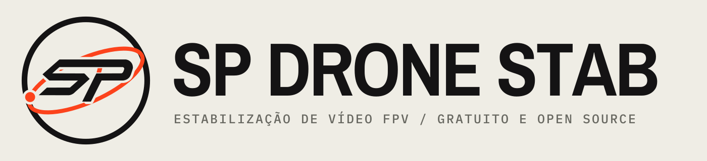

  <picture>
    <source media="(prefers-color-scheme: dark)" srcset="resources/brand/logo-horizontal-escuro.svg">
    
  </picture>

  <b>Free, open-source gyro stabilization for FPV video.</b> 
  <a href="README.pt-BR.md">Leia em português</a>

---

SP Drone Stab stabilizes FPV footage from the motion data your camera records. It is made for DJI O4 pilots and, above
all, for the O4 units whose gyro records false motion, which makes the usual corrections leave the video jumpy or wobbly
like jelly.

> **Status: in development.** There is no release yet. The first macOS test builds are being produced now. The features
> below are in the code but haven't been tested by users yet.

## What it does

- **Detects the O4 gyro problem on its own.** It reads the unit's production date from the serial number in the clip
  and tells you whether that unit likely has the ICM-40609-D gyro (DJI O4 Pro built since February 2026, and every O4
  Lite), which records false rotations under motor vibration.
- **Repairs the motion data before stabilizing.** It removes the false rotations and the single-axis tremor of that gyro
  from the motion data. This takes a fraction of a second and doesn't decode the video. It can also save a corrected
  copy of the clip (`<name>_gyrofix.MP4`).
- **Safe mode for the worst stretches.** Where the camera shakes hard for several seconds, even repaired motion data
  isn't reliable. SP Drone Stab finds those stretches automatically, stabilizes them from the image instead of from the
  gyro, and uses the gyro everywhere else. The timeline marks them in amber, and the app explains in plain words what
  it did. This is the same image-only stabilization as Gyroflow's "Ignore motion data from the file", but only where
  it's needed, so the rest of the clip keeps the gyro's precision and doesn't need the slower image analysis.
- **Everything Gyroflow 1.7.0 does**: lens profiles, rolling shutter correction, optical correction and sync, smoothing
  algorithms, GPU rendering, keyframes and the render queue.

## Download

There is no release yet. Releases will be published on the
[Releases page](https://github.com/fpvnicolas-byte/sp-drone-stab/releases).

Until then, test builds of open pull requests are available as build artifacts on the
[Actions page](https://github.com/fpvnicolas-byte/sp-drone-stab/actions) (you need to be signed in to GitHub). The macOS
build isn't signed by Apple, so on the first launch macOS blocks it: open **System Settings > Privacy & Security** and
click **Open Anyway**.

## Problems and suggestions

Open an issue [here](https://github.com/fpvnicolas-byte/sp-drone-stab/issues). Please don't take SP Drone Stab
problems to the Gyroflow or FPV Flow projects: they don't maintain this app.

## Where it comes from

SP Drone Stab is built on the work of these open-source projects, and wouldn't exist without them:

- **[Gyroflow](https://github.com/gyroflow/gyroflow)**, by [Adrian Eddy](https://github.com/AdrianEddy) and
  contributors, GPL-3.0-or-later. The stabilization engine and almost all of the app come from Gyroflow 1.7.0.
  See the [Gyroflow README](https://github.com/gyroflow/gyroflow#readme) for its full feature list, supported cameras,
  authors and acknowledgements.
- **[FPV Flow](https://github.com/rodrigosclosa/fpvflow)**, by Rodrigo Sclosa, GPL-3.0-or-later. The Gyrogate detection
  and repair (`src/core/gyrogate`) is ported from FPV Flow.
- **[o4fix](https://github.com/vadimbryl/o4fix)**, by vadimbryl, MIT. FPV Flow's repair is a port of o4fix.

## Building

SP Drone Stab builds the same way as Gyroflow: see
[Gyroflow's development instructions](https://github.com/gyroflow/gyroflow#development) and use this repository instead.

## License

SP Drone Stab is distributed under the GPLv3 License with App Store Exception, like Gyroflow. See [LICENSE](LICENSE).

As additional permission under section 7, you are allowed to distribute [`gyroflow_core`](src/core) through an app
store, even if that store has restrictive terms and conditions that are incompatible with the GPL, provided that the
source is also available under the GPL with or without this permission through a channel without those restrictive
terms and conditions.

The binary links against mdk-sdk, which is closed-source and not licensed under the GNU GPL. An additional permission
is granted allowing linking with mdk-sdk. mdk-sdk is distributed under its own license.

The copyright notices of Gyroflow's and FPV Flow's authors are kept in the source files they wrote.
