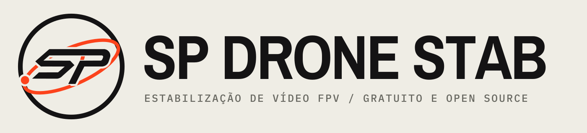

  <picture>
    <source media="(prefers-color-scheme: dark)" srcset="resources/brand/logo-horizontal-escuro.svg">
    
  </picture>

  <b>Estabilização de vídeo FPV pelo giroscópio, gratuita e de código aberto.</b> 
  <a href="README.md">Read in English</a>

---

O SP Drone Stab estabiliza vídeos FPV usando os dados de movimento que a câmera grava. Ele foi feito para quem voa com
a DJI O4 e, principalmente, para as unidades da O4 cujo giroscópio grava movimentos falsos, o que faz as correções
comuns deixarem o vídeo pulando ou com aspecto de gelatina.

> **Situação: em desenvolvimento.** Ainda não há versão publicada. As primeiras versões de teste para macOS estão sendo
> geradas agora. Os recursos abaixo já estão no código, mas ainda não foram testados por usuários.

## O que ele faz

- **Detecta sozinho o problema do giroscópio da O4.** Lê a data de fabricação da unidade pelo número de série gravado no
  vídeo e avisa se ela provavelmente tem o giroscópio ICM-40609-D (DJI O4 Pro fabricadas a partir de fevereiro de 2026 e
  todas as O4 Lite), que grava rotações falsas com a vibração dos motores.
- **Conserta os dados de movimento antes de estabilizar.** Remove as rotações falsas e o tremor em um eixo só que esse
  giroscópio grava. Leva uma fração de segundo e não precisa decodificar o vídeo. Também pode salvar uma cópia corrigida
  do arquivo (`<nome>_gyrofix.MP4`).
- **Modo seguro para os piores trechos.** Onde a câmera chacoalha forte por vários segundos, nem os dados consertados
  são confiáveis. O SP Drone Stab encontra esses trechos sozinho, estabiliza eles pela imagem em vez do giroscópio e usa
  o giroscópio no resto do vídeo. A linha do tempo marca esses trechos em âmbar, e o app explica em palavras simples o
  que fez. É a mesma estabilização só pela imagem do "Ignore motion data from the file" do Gyroflow, mas apenas onde
  precisa: o resto do vídeo mantém a precisão do giroscópio e não precisa da análise de imagem, que é mais lenta.
- **Tudo o que o Gyroflow 1.7.0 faz**: perfis de lente, correção de rolling shutter, correção e sincronização óptica,
  algoritmos de suavização, renderização na placa de vídeo, keyframes e fila de renderização.

## Download

Ainda não há versão publicada. As versões vão sair na
[página de Releases](https://github.com/fpvnicolas-byte/sp-drone-stab/releases).

Até lá, as versões de teste ficam disponíveis como artefatos de compilação na
[página Actions](https://github.com/fpvnicolas-byte/sp-drone-stab/actions) (é preciso estar logado no GitHub). A versão
de macOS não é assinada pela Apple, então na primeira vez o macOS bloqueia a abertura: vá em **Ajustes do Sistema >
Privacidade e Segurança** e clique em **Abrir Mesmo Assim**.

## Problemas e sugestões

Abra uma issue [aqui](https://github.com/fpvnicolas-byte/sp-drone-stab/issues). Por favor, não leve problemas do SP
Drone Stab aos projetos Gyroflow ou FPV Flow: eles não mantêm este app.

## De onde ele vem

O SP Drone Stab é construído sobre o trabalho destes projetos de código aberto, e não existiria sem eles:

- **[Gyroflow](https://github.com/gyroflow/gyroflow)**, de [Adrian Eddy](https://github.com/AdrianEddy) e
  colaboradores, GPL-3.0 ou posterior. O motor de estabilização e quase todo o app vêm do Gyroflow 1.7.0. Veja o
  [README do Gyroflow](https://github.com/gyroflow/gyroflow#readme) para a lista completa de recursos, câmeras
  suportadas, autores e agradecimentos.
- **[FPV Flow](https://github.com/rodrigosclosa/fpvflow)**, de Rodrigo Sclosa, GPL-3.0 ou posterior. A detecção e o
  conserto do Gyrogate (`src/core/gyrogate`) foram trazidos do FPV Flow.
- **[o4fix](https://github.com/vadimbryl/o4fix)**, de vadimbryl, MIT. O conserto do FPV Flow é uma adaptação do o4fix.

## Como compilar

O SP Drone Stab compila do mesmo jeito que o Gyroflow: veja as
[instruções de desenvolvimento do Gyroflow](https://github.com/gyroflow/gyroflow#development) e use este repositório.

## Licença

O SP Drone Stab é distribuído sob a licença GPLv3 com exceção para lojas de aplicativos, como o Gyroflow. Veja
[LICENSE](LICENSE). O texto em inglês do [README](README.md#license) é o que vale para as permissões adicionais
(distribuição do `gyroflow_core` em lojas de aplicativos e uso do mdk-sdk, que é de código fechado e tem licença
própria).

Os avisos de copyright dos autores do Gyroflow e do FPV Flow continuam nos arquivos de código que eles escreveram.
